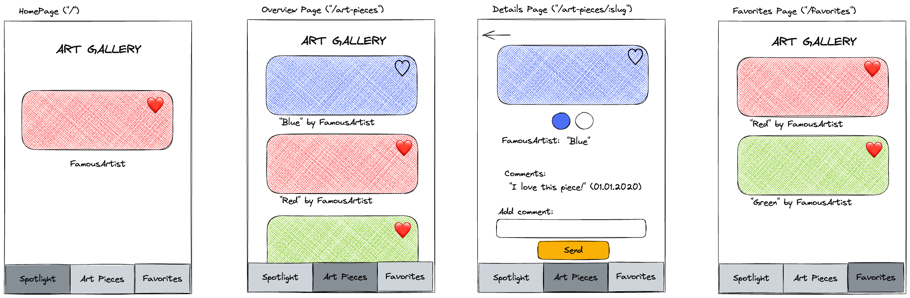

# Recap Project 5: Art Gallery

In this project, your team will create an interactive art gallery app with React, TypeScript and React Router.

This is a group project, so please create **only one project per group** following the [guide in the template section](#template).

## Overview

We will create an art gallery app with four pages: **Spotlight**, **Gallery**, **Favorites** and **Details**. Users can like or unlike art pieces, and liked pieces appear on the **Favorites** page. Users can also comment on art pieces. As a bonus, favorites and comments are saved in the browser.



To open the wireframes file `wireframes.excalidraw.png` in VS Code, install the [excalidraw extension](https://marketplace.visualstudio.com/items?itemName=pomdtr.excalidraw-editor).

## API

We fetch all necessary information about the art pieces from an API specifically designed for this course. [Check out the API](https://example-apis.vercel.app/api/art).

```bash
https://example-apis.vercel.app/api/art
```

An art piece looks like this. The type `ArtPiece` in `src/types.ts` describes it:

```json
{
  "slug": "wheat-field-with-cypresses",
  "artist": "Vincent van Gogh",
  "name": "Wheat Field with Cypresses",
  "imageSource": "https://example-apis.vercel.app/assets/art/wheat-field-with-cypresses.jpg",
  "year": "1889",
  "genre": "Landscape Painting",
  "colors": ["#37412E", "#8D7332", "#838665", "#718F98", "#9DA59E"],
  "dimensions": { "height": 1528, "width": 1920, "type": "jpg" }
}
```

## Template

Do not work in this folder. Create the repository of your group from the GitHub template repository [web-recap-project-5](https://github.com/wd-bootcamp/web-recap-project-5) and follow the [guide to setup your repository](https://github.com/wd-bootcamp/web-recap-project-5/blob/main/docs/github-respository-template.md). The template contains the same starter project as this folder, and the user stories below are created as predefined issues in your repository.

> 💡 **Reminder**: Work on feature branches to avoid merge conflicts!

> 📝 **Note for coaches**: The user stories below are a copy of the issue templates in [`.github/templates`](https://github.com/wd-bootcamp/web-recap-project-5/tree/main/.github/templates) of the template repository. If you change a story, change it in both places.

## Starter project

The template is a [Vite](https://vite.dev/) project with React, TypeScript, [React Router](https://reactrouter.com/) and [SWR](https://swr.vercel.app/) already installed:

- `src/index.tsx` wraps the app with `BrowserRouter`.
- `src/App.tsx` is your starting point.
- `src/types.ts` contains the type `ArtPiece`.
- `src/styles.css` contains some basic styles. Feel free to change them.
- `vercel.json` makes sure that URLs like `/art-pieces/the-harvesters` also work after deploying and reloading the page.

Run `npm run check` regularly: it type-checks your project with TypeScript.

## Deploying Your Project

🚀 Project deployment to Vercel is required: Please follow [these instructions](https://github.com/wd-bootcamp/cohort-template/blob/main/docs/deployment-vercel.md) to deploy the project on Vercel. Vercel detects Vite automatically.

## Working in the Team

- Each user story is one issue. Assign each issue to a team member and work on the issues in sequence.
- Only one issue per team member should be in the "In Progress" column at any given time.
- Open a pull request for every issue and review each other's pull requests before they are merged into `main`.

## User Stories

This app has four main pages: **Spotlight**, **Gallery**, **Favorites** and **Details**. Each page needs access to the art pieces. Think about where to fetch and store the data so that all pages can reach it.

<details>
<summary>Hint ✨</summary>

Fetch the art pieces once in `App.tsx` with `useSWR` and pass them down as props to the pages that need them. Components rendered by a `Route` can only get data from props, context or their own hooks.

Remember to type everything: the fetched data, your state and the props of your components.

</details>

### 1. Gallery Page

The Gallery page displays a list of all art pieces. Each art piece's image, along with its artist's name and title, is shown.

#### Value Proposition

**As an** art enthusiast

**I want to** see a list of all art pieces

**so that** I can get an overview of each one.

#### Acceptance Criteria

- [ ] All art pieces are displayed in a list.
- [ ] Each art piece's image is displayed.
- [ ] Each art piece's title is displayed.
- [ ] Each art piece's artist's name is displayed.
- [ ] The list is available on the route `/art-pieces`.

#### Tasks

- [ ] Fetch the art pieces with `useSWR` and write a `fetcher` function that returns `ArtPiece[]`.
- [ ] Display a loading and an error state.
- [ ] Create a component to render the list of art pieces.
- [ ] Create a component to render each art piece preview.

<details>
<summary>Hint ✨</summary>

`response.json()` returns `any`. Annotate the result with your type and let the `fetcher` say what it returns:

```ts
async function fetcher(url: string): Promise<ArtPiece[]> {
  // ...
  const data: ArtPiece[] = await response.json();
  return data;
}
```

SWR only reports an `error` if the `fetcher` throws. Throw an `Error` when the response is not `ok`, like in React Data Fetching.

</details>

### 2. Spotlight Page

This page is the app's homepage. A random art piece image, along with its artist's name, is displayed as a spotlight feature.

#### Value Proposition

**As an** art enthusiast

**I want to** see a spotlight art piece

**so that** I can get inspirational highlights.

#### Acceptance Criteria

- [ ] One art piece is randomly selected as a spotlight feature.
- [ ] The image of the selected art piece is displayed.
- [ ] The artist's name for the spotlighted art piece is displayed.
- [ ] The spotlight is available on the route `/`.

#### Tasks

- [ ] Write a function to select a random art piece. [Refer to this resource](https://developer.mozilla.org/en-US/docs/Web/JavaScript/Reference/Global_Objects/Math/random#examples).
- [ ] Create a new component for the Spotlight page.

<details>
<summary>Hint ✨</summary>

If you pick the random art piece directly in the component body, it changes on every re-render (for example when the state changes). Think about how you can pick it only once.

</details>

### 3. App Navigation Design

Since we have multiple pages, we want to enable smooth navigation between them. All pages share a consistent layout.

#### Value Proposition

**As an** art enthusiast

**I want to** switch between the Spotlight and Gallery views

**so that** I can navigate the app easily.

#### Acceptance Criteria

- [ ] A navigation link labeled "Spotlight" is displayed.
- [ ] A navigation link labeled "Gallery" is displayed.
- [ ] Clicking "Spotlight" shows the Spotlight page.
- [ ] Clicking "Gallery" shows the Gallery page.
- [ ] The link of the current page is visually highlighted.

#### Tasks

- [ ] Create a `Navigation` component that renders all navigation links.
- [ ] Render the `Navigation` component only once, ensuring it appears on all pages.
- [ ] Unknown URLs show a "Page not found" message.

<details>
<summary>Hint ✨</summary>

`NavLink` works like `Link`, but adds an `active` class to the link of the current page. Use the `end` prop for the link to `/`, otherwise it is active on every page.

</details>

### 4. Art Piece Details Page

When a user clicks on an art piece, they see all detailed information about it, along with an option to navigate back to the list of art pieces.

#### Value Proposition

**As an** art enthusiast

**I want to** view detailed information about an art piece

**so that** I can learn everything about it.

#### Acceptance Criteria

- [ ] Clicking on an art piece from the list navigates to the detail page.
- [ ] The details are available on the route `/art-pieces/:slug`, for example `/art-pieces/the-harvesters`.
- [ ] The art piece's image is displayed.
- [ ] The art piece's title is displayed.
- [ ] The art piece's artist is displayed.
- [ ] The art piece's year is displayed.
- [ ] The art piece's genre is displayed.
- [ ] A back button is displayed.
- [ ] Clicking the back button navigates back to the list view.
- [ ] An unknown `slug` shows an "Art piece not found" message instead of crashing.

#### Tasks

- [ ] Create a new component for displaying the art piece details.
- [ ] Create a **dynamic route** that renders the details of the selected art piece. Read the `slug` from the URL with `useParams`.

### 5. Mark Art Pieces as Favorites

Users want the ability to mark art pieces as favorites. Users can do this on the Gallery page, the Spotlight page and the Details page. The favorite button is reused on all of these pages.

#### Value Proposition

**As an** art enthusiast

**I want to** mark art pieces as favorites

**so that** I can find them more easily.

#### Acceptance Criteria

- [ ] The favorite button is displayed on each entry in the list view.
- [ ] The favorite button is displayed on the details view.
- [ ] The favorite button is displayed on the spotlight view.
- [ ] Clicking the favorite button on a non-favorite piece saves it as a favorite and provides a visual indication (for example a changing color or icon).
- [ ] Clicking the favorite button on a favorite piece removes it from the favorites and provides a visual indication.
- [ ] Favorite art pieces are visually highlighted to clearly show their favorite status.

#### Tasks

- [ ] Create a new component for the favorite button.
- [ ] Store this additional information (favorite status) in a state.

<details>
<summary>Hint ✨</summary>

All pages need to read and change the favorite status. The place for state that is shared by several routes is the component that renders the `Routes`: `App`.

Do not change the fetched art pieces. Store the additional information in your own state and connect it with the art pieces via the unique `slug`, for example:

```ts
type ArtPieceInfo = {
  slug: string;
  isFavorite: boolean;
};
```

You can find a heart icon on [Lucide](https://lucide.dev/icons/heart).

</details>

### 6. Favorites Page

The Favorites page displays a list of all favorite art pieces. Each art piece shows its image, artist's name, title and a favorite button.

#### Value Proposition

**As an** art enthusiast

**I want to** see a list of all my favorite art pieces

**so that** I can have an overview of my saved favorites.

#### Acceptance Criteria

- [ ] A navigation link labeled "Favorites" is displayed.
- [ ] Clicking "Favorites" shows the Favorites page on the route `/favorites`.
- [ ] All **favorite** art pieces are displayed in a list format.
- [ ] Each art piece's image, title and artist's name are displayed.
- [ ] Each art piece has an active favorite button.

#### Tasks

- [ ] Reuse an existing component to display only the favorite art pieces.

<details>
<summary>Hint ✨</summary>

You could write a function that checks whether an art piece is a favorite.

</details>

### 7. Comments for Art Pieces

To enhance user engagement, we add a commenting feature that allows users to write and view comments on each art piece. A comment section is displayed on the details page, showing the comments of the art piece being viewed.

#### Value Proposition

**As an** art enthusiast

**I want to** write comments on art pieces

**so that** I can note down my thoughts and ideas about the work.

#### Acceptance Criteria

- [ ] The detail view includes a section labeled "Comments" displaying a list of comments for this art piece.
- [ ] Each comment's text is displayed.
- [ ] Each comment's date and time are displayed.
- [ ] A form with a text field and a submit button is displayed.
- [ ] Submitting the form adds the comment to the list of this art piece, and only to this art piece.
- [ ] Empty comments cannot be submitted.

#### Tasks

- [ ] Create a `Comments` component and a `CommentForm` component.
- [ ] Type the comment, for example with `type Comment = { text: string; date: string }`.
- [ ] Extend the information you store for each art piece with its comments.

<details>
<summary>Hint ✨</summary>

It is best practice to consolidate related information into one state. If you already have `ArtPieceInfo` with the `slug` and `isFavorite`, add a `comments` property with a list of comments.

Use `new Date().toISOString()` to get a date you can store, and `new Date(dateString).toLocaleString()` to display it.

</details>

### 8. Show Color Palette

To enrich the information displayed on the details page, we add a color palette for each art piece.

#### Value Proposition

**As an** art enthusiast

**I want to** see the color palette of an art piece

**so that** I can find color inspiration.

#### Acceptance Criteria

- [ ] The art piece detail page displays a list of all colors used in the image.
- [ ] Colors are displayed visually, for example in circles or squares.

#### Tasks

- [ ] Create a new component for displaying the color palette.

### 9. Bonus: Persist Favorites and Comments in the Browser

This is a bonus story: work on it when all other stories are done. Currently, all data is saved using `useState`, which means it is lost upon page refresh. To improve the user experience, we want to persist it in the browser's local storage.

#### Value Proposition

**As an** art enthusiast

**I want** my favorites and comments to be saved

**so that** my data remains accessible even when I close or refresh the app.

#### Acceptance Criteria

- [ ] All favorite flags and comments on art pieces are persisted across browser reloads.
- [ ] Without any data in the local storage, the app still works.

#### Tasks

- [ ] Use `localStorage` to save the information on art pieces, including favorites and comments.

<details>
<summary>Hint ✨</summary>

The art pieces themselves are always fetched from the API. Only your own information (favorites and comments) is saved in the local storage.

- Read the saved value once when creating the state: `useState` accepts a function that returns the initial value, for example `useState<ArtPieceInfo[]>(loadArtPiecesInfo)`.
- Write the value with `localStorage.setItem(key, JSON.stringify(value))` in a `useEffect` that runs whenever the state changes.
- `localStorage.getItem(key)` returns `string | null` and `JSON.parse` returns `any`: handle the `null` case and annotate the parsed value with your type.

📙 Read more about [`localStorage`](https://developer.mozilla.org/en-US/docs/Web/API/Window/localStorage).

</details>

### 10. Bonus: Testing Components

As developers, we want to avoid repetitive manual testing by automating component tests.

#### Value Proposition

**As a** programmer

**I want to** automate component testing

**so that** I can identify bugs more easily.

#### Acceptance Criteria

- [ ] Automated tests cover the core components, ensuring they render and function as expected.

#### Tasks

- [ ] Write tests for the Spotlight component.
- [ ] Write tests for the art piece preview and the list of art pieces.
- [ ] Write tests for the navigation to confirm that the links are rendered correctly.
- [ ] Write tests for the art piece details to confirm that all details are displayed correctly.

<details>
<summary>Hint ✨</summary>

The project uses [Vitest](https://vitest.dev/) with React Testing Library, set up like in the React Component Testing session: `test`, `expect` and `vi` are available without imports, and `vi.fn()` replaces `jest.fn()`. Rendered components are cleaned up after each test automatically. Put a test file next to its component, for example `Navigation.test.tsx`, and run the tests with `npm run test`.

Components that contain a `Link` or `NavLink` need a router around them in a test. Wrap them in a `MemoryRouter` from `react-router`.

```tsx
render(
  <MemoryRouter>
    <Navigation />
  </MemoryRouter>
);
```

</details>

## Development

To work locally, please install the dependencies using `npm i` first (Node.js 22.22 or newer is required).

Run `npm run dev` to start a development server and open the displayed URL in a browser.

### Scripts

- `npm run dev` to start a development server
- `npm run build` to build the project
- `npm run serve` to preview the production build
- `npm run check` to type-check the project with TypeScript
- `npm run test` to run the tests with Vitest
